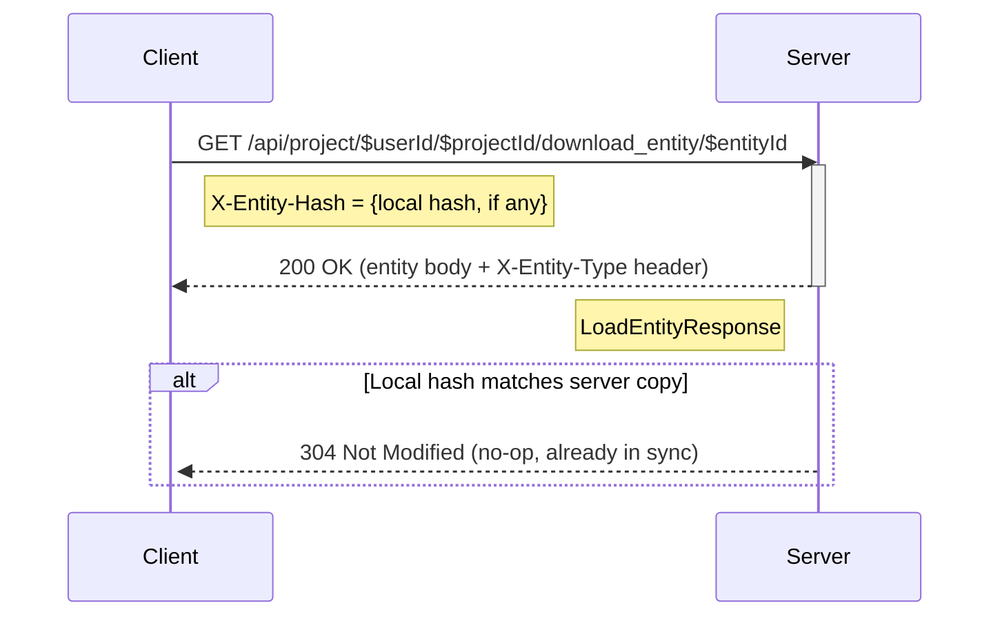
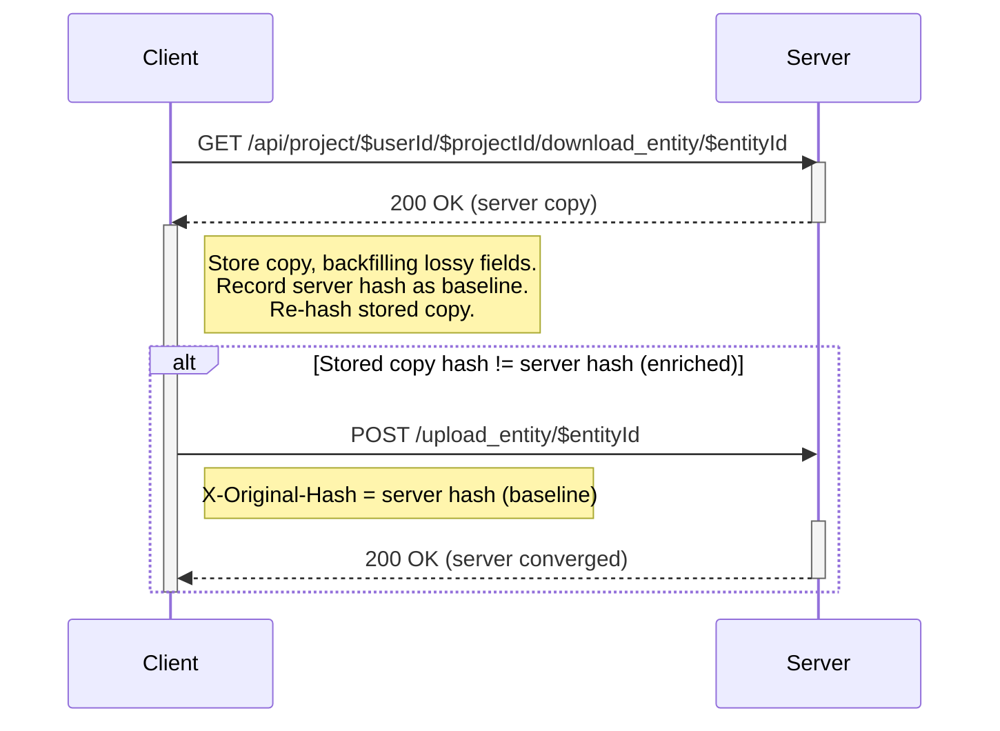
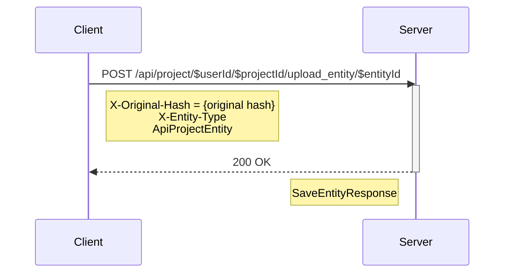
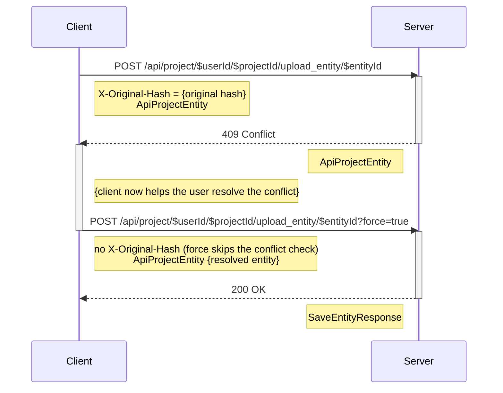
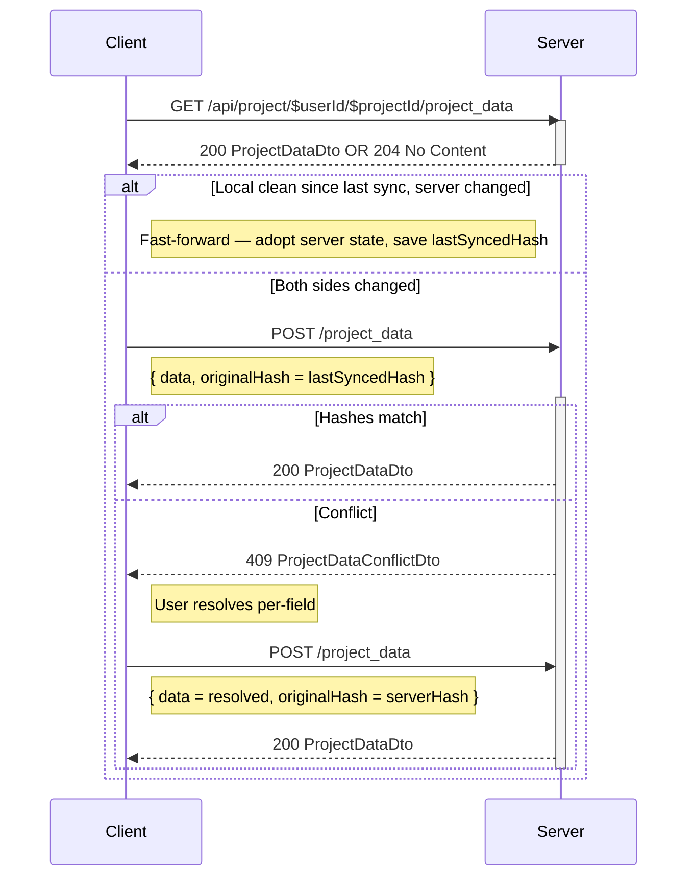
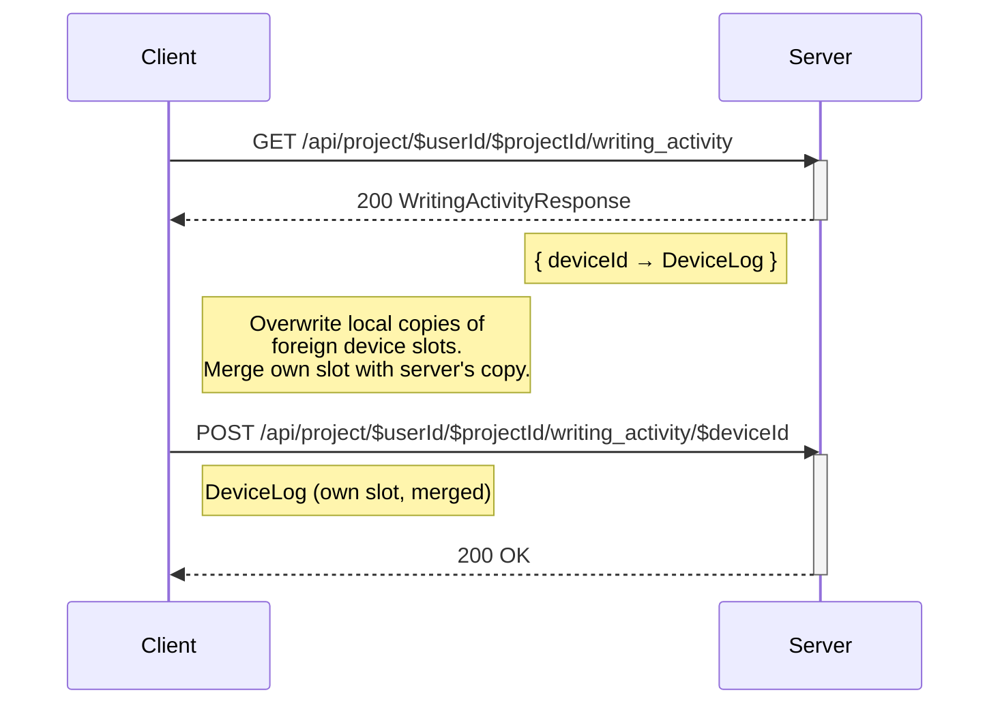
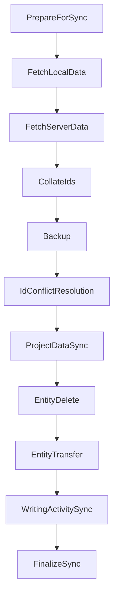

# Synchronization Protocol

This doc will try to give a brief (_as possible_) overview of the client/server synchronization
protocol Hammer
uses.

## Two levels of syncing

**Account Sync:** This synchronizes what projects the Account has, creating, deleting, renaming or
moving the project directories on the client, and the group directories they are nested in (see
[Project groups phase](#project-groups-phase)). It also carries the account-level **Story Ideas**
phase (see [Story Ideas Sync](#story-ideas-sync-account-level)).

**Project Sync:** This synchronizes an individual project and all of its Entities

---

## Account Sync Protocol

Before any project level syncing is done, we must first do an Account level sync.

This will handle creating, deleting, and renaming projects, to bring the client and server into
parity with each other.
Every local project already has a `projectId`, minted by the client when the project was created
(see [Persisted data tiers](ARCHITECTURE.md#persisted-data-tiers)). Account sync creates each local
project the server does not know under that same `projectId`, which is then the key to syncing the
project with the server.

### Phase ordering

The phases run **delete, then rename, then create**, and the order is load-bearing. A project name is
unique per account server-side, so until the delete has freed the name of a project the same session
is about to delete, a rename onto it is rejected and a creation under it adopts the doomed project.
Renaming a project onto a name another live project still holds answers `409 Conflict`.

### Project IDs

A project's `projectId` belongs to the client: it is minted locally when the project is created and
sent with the create request, and the server stores the project under it. Account sync classifies
each local ID against the `begin_sync` response:

- **Listed in `projects`:** the server has the project; nothing to create.
- **Listed in `deletedProjects`:** the ID is tombstoned. A tombstone records a real server-side
  delete and is permanent: the server refuses to create that ID again, and the delete phase removes
  the local project.
- **In neither:** the server has never seen the ID. The project is new, or it last synced against a
  different server (or one whose database has since been reset). The client creates it on the
  server under the same ID.

The classification uses the raw `begin_sync` response. A project the client has queued for
deletion is filtered out of the working copy of that list, but it is still known to the server, and
judging it against the filtered list would recreate what the user just deleted.

The create answers settle which ID the project keeps. Account sync and project sync resolve them the
same way (`ProjectCreateResolver`), except that only account sync, run from the project list, may
change a project's ID (see [Unknown project](#unknown-project-410-gone)). Account sync also leaves a
project that is in use (open in an editor or a background task) as it is: it does not adopt an ID
for it, create it on the server or rename it, and logs that the user should close it and sync
again.

- **Created, or already present under that ID:** the ID stands. The create is idempotent, so
  repeating it after a lost response is safe.
- **Same name, different ID:** the account already has a live project with that name, so the server
  answers with that project's ID (`alreadyExisted = true`) and the client adopts it. Adopting an ID
  clears the project's sync baseline, which described a different server project, except the entity
  baselines of a project flagged for a full conflict check (see **Dirty Entity**). If another local
  project already holds that ID (it was renamed away from this name and the rename has not reached
  the server), the client does not adopt it: the create counts as failed and is retried on a later
  sync, after the rename lands.
- **`409` with `project_id_taken`:** another account holds the ID. The client mints a fresh one and
  retries once.
- **`409` with `project_deleted`:** the ID is tombstoned on this account. The client does not retry,
  and logs that the project was deleted elsewhere.

A server project with no local counterpart is created locally under its ID, before any local
project is uploaded. A local project with the same name adopts the server's ID instead, unless it is
already bound to another live server project. So does a directory of that name with no
`project.toml`, which is then treated like a restored backup.

Renames are not queued: a project's name is reconciled against its sync baseline like its placement
(see [Project groups phase](#project-groups-phase)), so a project renamed outside the app syncs too.
Older clients queued renames; the first sync after upgrading turns each queued rename into a baseline
holding the server's current name, which makes the local name win, and drops one whose ID the server
does not list.

Queued deletes name a project by ID, so one the server cannot act on is dropped without being sent
rather than retried every session: a **delete** queued against an ID the server does not know is
dropped. The project was deleted before it ever reached the server, and a tombstone for its ID would
only refuse a later create of that ID.

Any given user account may only have one sync in progress at a time. Attempting to start a sync when
one is already in progress will result in a failure to begin the sync (`400 Bad Request`).

Account sessions expire after 2 minutes without activity (sliding, refreshed on each use); an
expired session may be reclaimed by anyone. Like Project sync sessions, a live account session may
also be **reclaimed by the same install** that owns it (identified server-side from the bearer
token), so a crashed account sync doesn't lock that device out until expiry. A different install
must wait for the live session to expire.

All account endpoints use `POST` (query params + headers).

```mermaid
sequenceDiagram
	participant Client as Client
	participant Server as Server

	rect rgb(1, 59, 15)
		Client ->> Server: POST /api/projects/{userId}/begin_sync
		activate Server
		Note right of Client: bearer token
		Server -->> Client: 200 OK (Sync Began)
		deactivate Server
		activate Client
		Note left of Server: syncId<br/>projects<br/>deletedProjects
		alt Sync already in progress
			Server -x Client: 400 Bad Request (sync ends here)
		end
	end
	rect rgb(74, 0, 9)
		loop Delete Projects
			Client ->> Server: POST /api/projects/{userId}/delete
			deactivate Client
			activate Server
			Note right of Client: bearer token <br/> syncId <br/> projectId
			Server -->> Client: 200 OK (Delete successful)
			deactivate Server
			activate Client
			alt Delete fails
				Server -->> Client: 4XX Bad Request
			end
		end
	end

	rect rgb(11, 0, 74)
		loop Rename Projects
			Client ->> Server: POST /api/projects/{userId}/rename
			deactivate Client
			activate Server
			Note right of Client: bearer token <br/> syncId <br/> projectId <br/> projectName
			Server -->> Client: 200 OK (Rename successful)
			deactivate Server
			activate Client
			alt Rename fails
				Server -->> Client: 4XX Bad Request
			end
		end
	end

	rect rgb(49, 0, 74)
		loop Create Projects
			Client ->> Server: POST /api/projects/{userId}/create
			deactivate Client
			activate Server
			Note right of Client: bearer token <br/> syncId <br/> projectName, projectId (query params)
			Server -->> Client: 200 OK (projectId, alreadyExisted)
			deactivate Server
			activate Client
			Note left of Server: projectId differs from the request<br/>when a same-name project is adopted
			alt Missing parameter or header, malformed projectId, or invalid syncId
				Server -->> Client: 400 Bad Request
			else Invalid project name
				Server -->> Client: 406 Not Acceptable
			else ID tombstoned or held by another account
				Server -->> Client: 409 Conflict (errorCode project_deleted or project_id_taken)
			end
		end
	end

	rect rgb(40, 30, 0)
		Note over Client,Server: Story Ideas phase (same session — see Story Ideas Sync below)
	end

	rect rgb(0, 15, 6)
		Client ->> Server: POST /api/projects/{userId}/end_sync
		deactivate Client
		activate Server
		Note right of Client: bearer token <br/> syncId
		Server -x Client: 200 OK (Sync completed)
		deactivate Server
	end

```



The `begin_sync` response also carries `ideasStateHash` — an account-wide hash of the server's
live idea set — which lets the client skip the Story Ideas phase entirely when nothing changed
(see below).

### Project groups phase

Projects can be nested in group directories. Each group has a client-minted `groupId` (stored in its
`group.toml`), a name (the directory name), an optional parent group and an optional description.
A project's placement is the id of the group directly holding it, or none at the top level. Paths are
never sent; they are derived from the parent links on each side.

`begin_sync` carries the server's tree: `groups` (each with `uuid`, `name`, `parentId`,
`description`) and a `groupId` on every entry of `projects`. Both are optional fields, so older
clients ignore them and older servers send none.

The groups phase runs inside the account sync session, in this order:

1. Project deletes (as above).
2. Group creates and updates, parents before children, so a child's parent already exists.
3. Project renames and moves.
4. Project creates, each passing the group it belongs in.
5. Group deletes, after everything has moved out of them.

| Endpoint | Input | Success | Failures |
|---|---|---|---|
| `POST /api/projects/{userId}/group/upsert` | JSON body `ApiGroupDefinition` | `UpsertGroupResponse(groupId, alreadyExisted)` | `400` malformed body or id; `406` invalid name or description over 2000 characters; `409` `group_name_taken`, `group_cycle`, `group_too_deep`, `group_id_taken` |
| `POST /api/projects/{userId}/group/delete` | `?groupId=` | `200` (also for an unknown group) | `400` missing or malformed id; `409` `group_name_taken` |
| `POST /api/projects/{userId}/move` | `?projectId=`, optional `?groupId=` (absent = top level) | `200` | `400` missing or malformed id; `404` unknown project |
| `POST /api/projects/{userId}/create` | adds optional `?groupId=` | `CreateProjectResponse` gains `groupId` | as above |

All of them require the session's `syncId` header, and every id is a UUID.

Server rules:

- **Upsert** creates the group under its client id, or updates the name, parent and description of
  the group already holding that id. An unknown parent places the group at the top level rather than
  failing. Sibling names are unique, ignoring case. A **new** group whose name a sibling already has
  is not created: the server answers with the sibling's id and `alreadyExisted = true`, and the client
  adopts it, as with project names. Renaming or moving an **existing** group onto a sibling's name is
  `group_name_taken`. Moving a group inside itself or a descendant is `group_cycle`. Nesting is capped
  at 8 levels (a top-level group is level 1), counting the whole subtree being moved: `group_too_deep`.
  An id another account holds is `group_id_taken`; the client mints a fresh one and retries once.
- **Delete** moves the group's child groups and projects up to its parent, then removes it. When a
  child group's name collides with a sibling at the parent, nothing changes and the answer is
  `group_name_taken`.
- **Move** and **create** treat an unknown `groupId` as the top level. A create that adopts an
  existing project (same id, or same name) never moves it; the response's `groupId` is where that
  project actually lives, which may differ from the request.

There are no group tombstones. A group deleted on one device disappears from `begin_sync`, and the
client tells "deleted on the server" apart from "created locally" by its sync baseline.

The client keeps a baseline of the last state both sides agreed on, per group (name, parent,
description) and per project (name, placement), in the account `sync.json`. Each attribute is
reconciled three ways:

- Local and server agree: nothing to do.
- No baseline yet: the server wins.
- Only the local side moved off the baseline: push the local value.
- Only the server moved off the baseline: apply the server value locally.
- Both moved: the server wins.

Because the comparison is against the files on disk, a folder renamed or dragged outside the app syncs
like an in-app change. A baseline is only written once an item fully agrees, so anything that failed
or was in use is retried next session.

---

## Pairing another install

Auth tokens are stored per `(userId, installId)`, and a refresh replaces that install's row, so two
devices can never share one token pair. A signed-in device mints a session for another of the
user's devices (the Wear OS app, which cannot type a password comfortably) with:

```
POST /api/account/pair_install/{userId}
  Authorization: Bearer <caller's token>
  form: installId=<the other device's install id>
  201: Token for the new install
```

- The caller's own install is derived from its bearer token, never from the request, and naming it
  is refused with `400`: minting over it would replace the caller's session.
- A blank or missing `installId` is `400`; a pending-deletion or disallowed account is refused the
  same way a token refresh is.
- Any *other* install id is accepted, and because `setToken` upserts on `(userId, installId)` it
  replaces whatever token that install held. Pairing the same watch twice therefore rotates its
  session, and naming a third device's install id signs that device out. Only the account's own
  authenticated caller can do this, and install ids are random UUIDs held on the device itself.
- It shares the login rate limit. The phone never stores a password, so this is the only way it can
  sign a watch in.

---

## Story Ideas Sync (account-level)

Story ideas are account-level content: markdown blobs with tags that live at the projects root
(`.ideas/idea-<uuid>.md`), outside any project. They sync as an extra **phase inside the account
sync session** — same `syncId`, same sliding expiry, no third session type. The full feature
design lives in [STORY-IDEAS.md](STORY-IDEAS.md); this section covers the protocol.

Ideas are keyed by **client-generated UUIDs**, so they don't participate in the Entity Update
Sequence and need none of the re-ID machinery — two devices can create ideas offline with zero
coordination.

### Endpoints

All under `/api/ideas/{userId}/…`, all requiring the account session's `syncId` header:

| Endpoint | Verb | Purpose |
| --- | --- | --- |
| `/state` | POST | `IdeasSyncStateResponse { ideas: [{id, hash}], deletedIdeas: [id] }` |
| `/idea/{ideaId}` | GET | Download one idea (`SavedIdeaDto { idea, hash }`) |
| `/idea/{ideaId}` | POST | Upload (`IdeaUploadRequest { idea, hash, originalHash? }`) |
| `/idea/{ideaId}/delete` | POST | Delete + write the permanent tombstone |

Upload responses: `200` with the saved copy; `409` + `IdeaConflictDto { server, serverHash }` on a
baseline mismatch; `410 Gone` if the idea is tombstoned (deletion wins — the client deletes its
local copy); `413` over the server's 64 KiB blob cap.

### The phase

1. Fetch `/state`: the server's live `{id, hash}` set plus deletion tombstones.
2. **Tombstones win**: prune local copies of tombstoned ideas and drop their bookkeeping.
3. Push the client's **pending-delete outbox**; each entry is erased on server ack.
4. Reconcile each local idea against the server set:
   - hashes agree → lock the baseline;
   - server-unknown or locally dirty (hash ≠ baseline) → upload with `originalHash = baseline`;
   - local clean but server changed → download the server copy.
5. Download server ideas the client doesn't hold (excluding ones still awaiting our delete).

### Hashing and conflict detection

Per-idea hashing (`IdeaHasher`, in `base` so both sides run byte-identical code) covers every
`StoryIdea` field, following the same evolution rules as `ProjectDataHasher`: presence bytes for
nullable fields, zero bytes for the empty tag set, guarded by golden-pin sensitivity tests.

Conflicts mirror project-data sync: the client persists a per-idea **baseline** (the hash last
agreed with the server) in `.ideas/sync.json` and replays it as `originalHash` on upload. A `409`
returns the server copy; the user resolves (either side, or a manual merge in the editable local
pane) and the resolution is re-uploaded with `originalHash = serverHash` from the conflict. An
unresolved conflict simply leaves the idea dirty for next session.

### Deletion propagation

Only the **server** keeps tombstones (`deleted_idea` rows, permanent). The client keeps a
transient `pendingDeletes` outbox in `.ideas/sync.json`, written at delete time and erased on
ack — required because "the server has an idea the client doesn't" is otherwise ambiguous between
*created elsewhere* and *deleted here*. Deletes are only recorded once the install has synced
ideas before (the sidecar's existence is the marker); a never-synced install just deletes the
file. Losing the sidecar degrades to baseline-less uploads and resurrected not-yet-pushed
deletions — annoying but never content loss.

### Skipping the phase (ideas state hash)

The `begin_sync` response carries `ideasStateHash`: an `IdeasStateHasher` hash over the server's
live `{uuid, hash}` pairs (sorted, size-prefixed; tombstones excluded). The client skips the
whole phase when **both** hold:

1. no pending local work — empty outbox, and every local idea hashes exactly to its locked
   baseline (which also rules out local-only or missing ideas), and
2. the hash of those baselines equals the server's `ideasStateHash`.

Tombstones can be excluded safely: a tombstone only matters to a client still holding the idea,
and that client's baseline set necessarily disagrees with the server's live set, forcing the
phase to run. The field is optional — a server that predates ideas omits it and the client runs
the phase unconditionally; any doubt on the client (corrupt sidecar, dirty ideas) also falls
back to running it. Same asymmetric-risk argument as the project probe: a false mismatch costs a
redundant phase, and a "false match" cannot exist while rule 1 holds, because a client never
skips with unsynced local changes.

### Server storage

Same shape-agnostic scheme as entities and project data: the serialized `StoryIdea` JSON is the
wire format, stored verbatim (encrypted at rest with the entity content-encryption path, covered
by key-rotation convergence and the key-prune in-use scan) alongside the client-supplied hash.
The server decodes only to validate shape, so adding a field to `StoryIdea` is a client-only
change.

---

## Pre-Sync Change Probe

Between Account Sync and Project Sync sits an optional optimization. Account Sync brings the *set* of projects into parity; the probe then asks, in a single batched request, *which* of those projects actually have content changes — so the client can skip the per-project sync for every project that has none.

This matters because a full project sync costs ~4 round-trips (`begin_sync`, `project_data`, `writing_activity`, `end_sync`) even when nothing has changed, paid once per project on every app open. The probe collapses that to one request for the whole account.

The probe keeps no required state of its own: a client or server that ignores it loses nothing but speed.

### The Project-Wide Hash

Each project gets a single **project-wide content hash** computed over the two data sources whose divergence is unacceptable:

- all of the project's **entities** (the same per-entity hashes already produced for `ClientEntityState`), and
- the **project-data blob** (author, theme, word-count goal — hashed via `ProjectDataHasher`).

The aggregate is order-independent of enumeration: sort the entity `{id, hash}` pairs by id, fold `id:hash` pairs plus the project-data hash through the same MurmurHash3 used elsewhere. The function lives in the `base` module (alongside `EntityHasher` / `ProjectDataHasher`) so the **client and server run byte-identical code**.

**Writing activity is deliberately excluded.** It is per-device, conflict-free, and the project's authoritative record is the *union* of every device's slot — so no single device ever holds the full set, and a symmetric content hash that included it would never match across devices. It is also explicitly auxiliary (its sync phase already swallows errors and retries next time), so a skipped opportunistic activity sync is consistent with the existing tolerance. The trade-off: a change that touches *only* another device's writing activity will not be detected by the probe, and is picked up on the next sync that runs for any other reason.

### Symmetric Comparison

The probe compares **the client's current hash against the server's current hash** — not "did the server change since I last synced." A local edit makes the client's hash differ; another device's push makes the server's hash differ; only when both currently agree is the project skipped. One comparison covers both directions, and the server recomputes its hash on demand from its stored state — no per-client bookkeeping, in keeping with the protocol's "no required book keeping data" principle.

### Network Protocol

```mermaid
sequenceDiagram
    participant Client
    participant Server

    Note over Client,Server: After Account Sync, before any Project Sync

    Client->>Server: POST /api/projects/{userId}/sync_probe
    activate Server
    Note right of Client: ProjectsSyncProbeRequest<br/>[ { projectId, hash } ]
    Note over Server: For each project, recompute the<br/>project-wide hash and compare
    Server -->> Client: 200 OK
    deactivate Server
    activate Client
    Note left of Server: ProjectsSyncProbeResponse<br/>{ unchangedProjects }

    Note right of Client: Skip unchangedProjects;<br/>sync everything else as normal.
    deactivate Client
```

- `POST /api/projects/{userId}/sync_probe` — read-only, no `syncId` required.
- Request `ProjectsSyncProbeRequest { projects: List<ProjectHashItem> }`, where `ProjectHashItem { projectId, hash }`.
- Response `ProjectsSyncProbeResponse { unchangedProjects: Set<ProjectId> }`.

The server returns a project in `unchangedProjects` **only** when it is certain it is in sync — the project exists and its freshly recomputed hash matches. It omits anything it cannot certify, including any project with an **in-flight sync session** (whose stored hashes may be mid-update). A project the client never sends, or the server never returns, is simply synced the normal way.

If the endpoint is unsupported (older server) or the request fails for any reason, the client silently falls back to a full per-project sync — no behavior change.

### Correctness

The risk is asymmetric:

- A **false mismatch** — the hashes differ but nothing needed syncing — is harmless: just a redundant full sync.
- A **false match** — skipping a project that was actually divergent — loses no data: skipping is a no-op on both sides, and the next sync still reconciles through the normal dirty/conflict machinery. The only cost is that the two stay divergent longer than they should.

So the one rule the client must uphold is: **never skip a project that has un-synced local changes.** As long as a local change is recorded before a project could be reported unchanged, the probe can only ever *defer* a sync, never hide one — it adds no divergence risk beyond what the existing change tracking already guards.

How the client decides a project is eligible — and how it caches its own project-wide hash to avoid re-hashing every entity on each open — is a client implementation detail, not part of the wire protocol.

---

## Project Sync Protocol

## Goal

The goal of this protocol is to synchronize the various `Entities` on the client to the server.

There is no file history as in a true version control system such as `git`. This is instead a simpler synchronization system, yet still smart enough to detect `conflicts`, and prevent edits on multiple devices from overwriting each other on accident.

As such, there is very little book keeping data, and none of it is actually required. When all actors are fully synchronized, they all contain the full set of data. Thus if the server were to die and lose all of its data, it wouldn't matter. Every client would contain everything necessary to
setup on a new server.

Further more, the protocol is fully fault tolerant. It may fail at any step along the way, and the state of the client and server will remain entirely valid, although not entirely synchronized.

## Network Protocol (overview)

This is largely a client driven synchronization process.

### SyncIDs
The client calls `begin_sync` to get a valid `syncID`. This `syncID` is provided to all subsequent calls, and is terminated with a call to `end_sync`.

There can be only one valid `syncID` per project at any given time. This prevents race conditions with two clients syncing the same project at the same time.

#### Reclaiming a session (same install only)

A stale session would otherwise lock a user out of their own project until it expires — for example when a prior sync's `end_sync` never reached the server (the client was cancelled mid-sync, lost auth, or dropped its connection). To avoid this, `begin_sync` may **reclaim** an existing project session, but only when the request comes from the **same install** that owns it.

The install is identified server-side from the authenticated bearer token (never a client-supplied value), so it cannot be spoofed. The rules are:

- **Same install** as the active session → the old session is terminated and a fresh `syncID` is issued. The previous `syncID` immediately becomes invalid.
- **Different install**, session still active → `400 Bad Request`; the original session keeps its claim, preserving the cross-device race protection above.
- **Expired session** (any install) → treated as gone and reclaimable by anyone. Sessions expire
  after 2 minutes without activity (sliding — refreshed each time the `syncID` is used).

The client also fires `end_sync` even when its sync is cancelled, so sessions are normally released cleanly; reclaim is the safety net for the cases where that request can't be delivered.

#### Unknown project (`410 Gone`)

A project endpoint called with a `projectId` the user doesn't own answers **`410 Gone`**, not `404`.
The distinction matters: `download_entity` maps a `404` to "entity deleted on the server" and, for
an entity it doesn't already hold, silently marks it deleted. A project-level `404` would therefore
make a client abandon undownloaded entities when a project vanishes mid-sync.

This is also how a project that has never synced reaches the server: there is no separate
pre-check, `begin_sync` is the probe. Retrying `begin_sync` alone can never succeed, so on
receiving `410` from it the client runs the same create-or-confirm as account sync
(`ProjectCreateResolver`, see [Project IDs](#project-ids)) under its local ID, in an account sync
session of its own. Project sync runs on a project that is in use, so it never changes the
project's ID: if the server answers with a same-name project's ID or `project_id_taken`, nothing
changes locally and the sync fails, telling the user to close the project and sync from the
project list, where account sync adopts or re-mints the ID. Otherwise the client clears the
project's sync baseline, since that described a server project which no longer holds it, and
retries `begin_sync` once. If the create answers `project_deleted`, refuses to adopt an ID another
local project holds, or fails, the sync fails with a log saying so instead. Without this repair the
project would fail every sync, because account sync (above) is not run when syncing a single
project from inside the project itself.

You may however have `syncID`s for multiple different projects simultaneously.

These are Project level `syncID`s. Account syncing use separate Account level `syncID`s. There may only be one valid Account level `syncID` at a time, and if there is a valid Account `syncID`, then no Project level `syncID`s are allowed to be created. The Account level sync must finish before any Project level syncs may begin.

### Entity Update Sequence
The server will inspect the provided ClientState, and then return a sequence of Entity IDs: every server Entity the client is missing or holds a different version of (compared by hash). The client synchronizes those IDs in that order, then appends any local Entities the server doesn't know about yet (IDs above the server's `lastId`).

`ProjectEntityRepository.getUpdateSequence` lists Images first, then scenes, drafts, notes, timeline events and encyclopedia entries: every other type can refer to an Image, so a device receives the image before the text that embeds it. Drafts follow the scenes that own them.

### Remote Entity Deletion
The last step before individual Entity synchronization can begin is having the Client notify the server of any locally deleted Entities.

```mermaid
sequenceDiagram
    participant Client
    participant Server

    Client->>Server: POST /api/project/$userId/$projectId/begin_sync
	activate Server
	Note right of Client: body: ClientEntityState (gzip)<br/>per-entity { id, hash }

	Server -->> Client: 200 OK (Sync Began)
	deactivate Server
	activate Client
	Note left of Server: ProjectSynchronizationBegan

    rect rgb(74, 0, 9)
        loop Delete Entities
            Client->>Server: GET /api/project/$userId/$projectId/delete_entity/$id
            deactivate Client
            activate Server
            
            Server -->> Client: 200 OK
            deactivate Server
            activate Client
            Note left of Server: DeleteIdsResponse
        end
    end

    rect rgb(11, 0, 74)
        loop Transfer Entities
        Note right of Client: See breakout section for details
			Client ->> Server: [various]
			Server ->> Client: [various]
        end
    end

    Client->>Server: POST /api/project/$userId/$projectId/end_sync
	deactivate Client
	activate Server
	Note right of Client: X-Sync-Id header<br/>lastSync, lastId (form params)
	Server -->> Client: 200 OK (Sync Terminated)
	deactivate Server
	activate Client
```



## Network Protocol (Entity Transfer)
The Client now attempts to sync each ID provided in the server in the `Entity Update Sequence` in the order provided.

It will now either upload or download each ID depending on what it infers from the combined Client and Server state that has been transferred so far.

### Download
The client has determined that it needs to download the Server's copy of an Entity. This is either because the client is simply missing the Entity, or it has determined that the server has a newer version and it wants to overwrite the local client copy with the server copy.

If the client has a local copy, it sends that copy's hash in the `X-Entity-Hash` header. When it matches the server's copy, the server answers `304 Not Modified` and the client records the Entity as synchronized without transferring the body. It also records that local hash as the Entity's conflict baseline (`EntityTransferOperation.downloadEntry`): the server just confirmed it, and a baseline left stale by a hasher change would otherwise raise a false conflict on the next edit.

If the server answers `404 Not Found` (an ID in the sequence with no server entity — only possible through server-side data loss or an allocation gap), the client self-heals by whichever side still holds the truth: if it has no local copy either, it records the ID as deleted so it stops appearing in future syncs; if it does hold a copy, it re-uploads it with no conflict baseline to restore the server's. Known deletions are skipped before this point, so the restore can never resurrect an intentionally deleted Entity.


#### Stale Hash Read-Repair (server-side)

The server stores a per-entity hash alongside the entity content. That hash is derived metadata —
the content is the truth. If the hash algorithm or serialized shape changes between when a row was
written and when it's next read (schema evolution, adding fields to entities), the stored hash goes
stale.

The server repairs this itself, lazily, on download: when loading an entity it compares the stored
hash against a hash freshly computed from the content, and on mismatch it rewrites the stored hash
and serves the download normally. The client never sees the repair. Because a stale hash also makes
the entity look changed to the `Entity Update Sequence` check, every stale entity is guaranteed to
be offered for download, so lazy repair converges without any O(n) sweep.

#### Post-Download Enrichment Heal (client-initiated)

The read-repair above is driven by the *server* noticing its own hash is stale. A second,
complementary heal is driven
entirely by the *client*, at the download chokepoint.

If a downloaded entity hashes differently once it's been stored, because storing it backfilled or
normalized a field the
server left null or absent, the local copy no longer matches the server's. Left alone, the server
keeps offering that
entity for download on every sync, so it re-downloads forever.

To break the loop, right after recording a successful download the client re-hashes its stored copy
against the server's
hash. If they differ, it uploads the enriched copy back, using the server's just-recorded hash as
the conflict baseline
(`original hash`). Because the sync session holds the project lock, the server's copy cannot change
between the download
and this upload, and the baseline is exactly what the server holds — so the heal always applies
cleanly, with no conflict
and no `force`.



### Upload
The client has determined that it needs to upload the local Client copy of an Entity. This is either because the server is missing the entity, or the client has a dirty copy that needs to be synchronized.

#### No conflict
In the nominal case, the server will accept the incoming entity, and simply overwrite the Server's own copy with it. The server knows this is safe to do so because it compares the Server copy's hash, with the provided `original hash`. If they match, the Server knows that the Client was editing the same copy which the server will now replace.


#### Conflict detected
In the case where the Server and Client's `original hash` do not match, there is a conflict.

The server infers from this that the client was editing a different version of the Entity than what the server now has. This is probably because a different client uploaded an independent edit of the Entity.

The server will respond with its copy of the Entity and require the Client to resolve the conflict by resubmitting the upload with `force=true` set.

Note that the resolved `ApiProjectEntity` in the `force` request does not have to be exclusively the Client's or Server's copy, it can be a merging between the two that the client helped the user create.

#### Stale stored hash

The stored hash column can be stale (see [Stale Hash Read-Repair](#stale-hash-read-repair-server-side)), and the conflict check reads the column, not the content. So on a mismatch `ServerEntitySynchronizer.checkForConflict` loads the stored Entity and recomputes its hash; when that equals the client's `original hash`, the client saw exactly this version, the upload is accepted, and storing it rewrites the column. Only when the recomputed hash also differs is it a conflict. This keeps an Entity whose hash algorithm or shape changed (an encyclopedia entry that lost its inline image, for example) from conflicting on its first upload after the change, whether or not a download has repaired the column first.

Uploads carry an `X-Entity-Type` header (the server rejects an upload without one, and answers `409` on a type mismatch, a distinct conflict from the hash conflict above). Before the conflict check, and for `force` uploads too, the type's `ServerEntitySynchronizer.validate` may reject the Entity: `400 Bad Request` for `EntityValidationException`, `413 Payload Too Large` for `EntityTooLargeException` (see [Images](#images)). An upload may also fail with `413` when the encrypted content exceeds the server's row cap, or `417 Expectation Failed` for a non-conflict save failure.

## Images

### Image entities

An Image is a synced Entity holding one picture file: `ApiProjectEntity.Type.IMAGE` (`5`, string id `image`). Other Entities refer to it by Entity id (see [Image references](#image-references)). The wire shape is `ApiProjectEntity.ImageEntity`:

| Field | Content |
|---|---|
| `id` | Entity id |
| `name` | Display name; the client stores the file as `images/<id>~<name>.<ext>`, the name run through `FilenameEncoding` |
| `fileExtension` | One of `ImageFormat.ALLOWED_EXTENSIONS` |
| `base64` | The raw file bytes, URL-safe base64 |

The file travels inline in the upload and download bodies, so a reverse proxy must accept bodies of about 11 MB (see the nginx examples in [HOW-TO-RUN-A-SERVER.md](HOW-TO-RUN-A-SERVER.md)).

`EntityHasher.hashImage` hashes the decoded bytes, not the base64 text: the id, then `name.length` and `name`, then `fileExtension.length` and `fileExtension`, then `bytes.size` and the bytes. The length prefixes keep adjacent fields from bleeding into each other (`"ab"` + `"c"` against `"a"` + `"bc"`).

### Validation

`ImageFormat` (in `base`) holds the rules, so client and server apply the same ones:

- **Extension**: `jpg`, `jpeg`, `png`, `webp`, `gif` or `svg`, ignoring case.
- **Size**: at most `MAX_IMAGE_BYTES` (8 MiB) decoded.
- **Content**: `sniff` checks the magic bytes for the extension (the PNG signature, `FF D8 FF` for JPEG, `RIFF` then `WEBP` at offset 8, `GIF8`). An SVG must have `<svg` as its root element: within the first 1024 bytes, after an optional BOM, XML declarations, comments and a DOCTYPE (internal subset included).
- **Name**: `ImageFormat.isValidName`, which requires a valid `ProjectNameValidator` name that comes back unchanged from `FilenameEncoding.encode` then `decode`. The name is a filename on the client; one that does not round-trip would read back different, hash differently and re-sync forever, so the server refuses it too.

`ServerImageSynchronizer.validate` answers `400` (`EntityValidationException`) for base64 that does not decode, an invalid name, an unsupported extension or content that does not match it, and `413` (`EntityTooLargeException`) over the size cap. `ClientImageSynchronizer.storeEntity` applies the same `ImageFormat.validate` to a download and refuses to store an image that fails it.

### Encyclopedia entry images

`EncyclopediaEntryEntity.images: List<Int>` holds Image ids in display order; the first is the primary image. An entry carries no image bytes. `hashEncyclopediaEntry` appends the list only when it is non-empty: its size, then each id in list order (not sorted, since the order is meaningful). An entry without images keeps its stored hash.

Entry rows stored before images were Entities carry an inline `image` object. Both JSON serializers (`createJsonSerializer`, `createNetworkJsonSerializer`) set `ignoreUnknownKeys`, so those rows still decode and the inline bytes are dropped. Server-side inline images are not converted to Image Entities; only the copies still on a device's disk survive, through the client migration:

- Data version 5 (`Migration4_5`, which calls `EntryImagePromoter`) moves each on-disk entry image to an Image named after its entry and lists it in the entry's `images`.
- When the project has a `sync.json`, the promoter adds the new image ids to `newIds` and each entry that gained one to `dirty`, so the next sync uploads both. For an entry that was clean, it sets the baseline (`syncedHashes[id]`) to the hash of the entry's content before promotion. The server's hash column for that entry may still hold the old hash, which covered the inline image bytes. If this device uploads first, the baseline matches the hash the server recomputes from its stored content (see [Stale stored hash](#stale-stored-hash)). If another device downloaded the entry first, the read-repair already rewrote the column to that same hash. Either order is conflict-free. An entry that was already dirty keeps its baseline.
- `DataMigrator` runs `EntryImagePromoter` again on every launch for projects at data version 5 or later, so an image a failed move left behind is promoted later.

Two devices that migrate the same entry before either syncs each create an Image for it. The entry then conflicts; whichever side the user keeps, the other Image stays in the project, unused.

### Image references

Markdown in scenes, drafts, notes, timeline events and entry text embeds an image as a line of its own, `` (`ImageReferenceSyntax`). Entries also refer through `images`, and project data through `coverImageId`. Because references hold Entity ids, a [Re-ID](#terminology) has to rewrite them, and the rewritten referrers have to upload in the same sync.

`EntitySynchronizer.reIdEntity(oldId, newId)` returns the ids of other Entities whose stored content the re-ID rewrote. `ClientImageSynchronizer` renames the file, then runs `ImageReferenceRewriter.remap`; `ClientEncyclopediaSynchronizer` returns the scenes whose entry references `SceneMetadataReferenceRemapper` rewrote. The other types return an empty set.

During `IdConflictResolution`, `IdConflictResolutionOperation` collects these from each `EntityIdChange.rewrittenReferrers` and resolves them through the final old-to-new id map, since a referrer may itself be re-IDed later in the loop. Each one not already dirty joins the dirty list with its synced baseline (`syncedHashes[id]`), and all of them go into `CollatedIds.rewrittenIds`. `EntityTransferOperation` visits `rewrittenIds` as well as the server's `idSequence`, because a referrer the server already holds unchanged is not in the sequence. Otherwise the sync would finish, clear the dirty list, and the next sync would download the server's copy over the rewrite. The cross-type renumbering that runs when a project opens (`DuplicateIdService`) marks the returned referrers dirty the same way.

`ImageReferenceRewriter` covers every holder of a reference:

| Holder | Rewritten | Reported for sync |
|---|---|---|
| Encyclopedia entries | text and `images` | yes |
| Scenes | text, through the loaded buffer when there is one, so an open editor follows | yes |
| Archived scenes | the scene file | yes |
| Unrestored scene edits | unsaved edits an earlier session left on disk | no |
| Drafts | draft content | yes |
| Notes, timeline events | text | yes |
| Project cover | `coverImageId` | no |

Unrestored edits stay local until they are restored and saved; reporting the scene would upload its unchanged file over newer server changes. The cover is project data, written through `ProjectDataRepository.updateData`, which the project data phase uploads (see [Project data fields](#project-data-fields)). Deleting an image runs `ImageReferenceRewriter.removeAll` first, which removes each Markdown reference (the whole line for a block image), takes the id out of `images` and clears the cover. Another device's `ClientImageSynchronizer.deleteEntityLocal` deletes only the file, since the rewritten referrers arrive as Entity updates of their own.

## Project Data Sync (non-entity blob)

In addition to entity sync, each project has a single per-project blob holding user-authored settings (author name, theme colors, word-count goal, tags, language, spell-check dictionary, book cover). This blob is synced as its own phase, inserted into the pipeline *before* the entity phases (entity deletion, then entity transfer) so the project's identity is settled before any entity churn.

The blob is a structured object — see `ProjectData` in the `base` module — but is treated as a single unit at the sync layer. Conflict detection is hash-based, mirroring entity sync: the client persists the `lastSyncedHash` it most recently agreed on with the server and replays it on the next upload.



Two further branches aren't diagrammed: if the server has no blob yet (`204`) and the local data is non-default, the client uploads with a null `originalHash` (the server accepts a baseline-less upload unchecked); and if the hashes already match, the phase is a no-op (re-recording `lastSyncedHash` if it was stale).

One field is exempt from the per-field resolver: `dictionaryWords` (the project's user spell-check
dictionary) is merged by union on both paths. When a `409` differs from the local copy *only* in that
field, the client merges and re-uploads without involving the user; when other fields also differ, the
resolver appears for those and the dictionary is still unioned. A word deleted on one device is therefore
resurrected if the other device conflicts before the deletion syncs; that is accepted for a word list.

Sync writes never clobber a concurrent local edit: the client snapshots the blob when the phase
starts, and when it installs the server-agreed state it re-applies any field the user changed since
that snapshot (dictionary words as an add/remove delta). Those edits then differ from the recorded
`lastSyncedHash`, so the next sync uploads them.

Unlike writing-activity sync (which swallows errors and continues), a non-conflict failure on the project-data phase fails the whole sync — the data is user-authored and silent loss is unacceptable.

Note: unlike the entity endpoints, the `project_data` and `writing_activity` endpoints are not gated on a `syncID` — they simply run inside the sync session window.

### Project data fields

How each `ProjectData` field feeds `ProjectDataHasher` and how a conflict on it is resolved. Fields
added after the first release contribute zero bytes at their default and open with a negative marker,
so older hashes stay byte-identical and no block can be read as the tail of another.

| Field | Hash contribution | On conflict |
|-------|-------------------|-------------|
| `authorName` | presence byte `0`/`1`, then the string | per-field pick |
| `theme` | presence byte, then primary and secondary | per-field pick, as a unit |
| `wordCountGoal` | presence byte, then cadence ordinal and count | per-field pick, as a unit |
| `tags` | nothing when empty; else size, then the sorted tags | per-field pick, the whole set |
| `language` | nothing when null; else `-1`, length, string | per-field pick |
| `encyclopediaDictionary` | nothing when `true`; else `-2` | per-field pick |
| `dictionaryWords` | nothing when empty; else `-3`, size, then each sorted word as length and string | union of both sides |
| `coverImageId` | nothing when null; else `-4`, then the id | per-field pick |

`coverImageId` holds an Image entity id. The client rewrites it like any other image reference: a
re-ID during id resolution remaps it and deleting the image clears it, both through the project data
repository, so the project data phase (which runs after id resolution) uploads the change in the
same sync.

### Server storage is shape-agnostic

Server storage never depends on client data shape: synced content — entities, project data, and
story ideas alike — is stored as an opaque blob with a **client-supplied** hash. The server never decodes the
blob into the typed model except to *validate* that it decodes at all (`ignoreUnknownKeys`, so
fields it doesn't know still pass); on upload it stores the received JSON verbatim (`hash` field in
the upload request), and on download/conflict it passes the stored bytes back untouched (
`RawProjectData*` DTOs server-side, `JsonElement` data slots). A stored row that no longer decodes
is treated as missing, so the next client upload heals it.

This makes adding a field to a synced model a **client-only** change:

1. Add the field to the model (in `base`) with a serialization default, so old data deserializes.
2. Fold the field into its hasher such that the empty/absent value contributes **zero bytes** —
   existing hashes (stored `lastSyncedHash` baselines, server rows) must stay byte-identical. Hash
   collections in sorted order with a size prefix (see `tags` in `ProjectDataHasher`).
3. Update the hash-sensitivity guard (`EntityHashSensitivityTest` fails automatically until the new
   field provably affects the hash).

The server needs no update, and no protocol bump is required.

**Mixed app versions within one protocol version.** A not-yet-updated client's typed decode strips
fields it doesn't know, so its stored copy of downloaded project data hashes differently from the
server row. To keep that from destroying data, the fast-forward path records `lastSyncedHash` as the
hash of **what it actually stored**, not the server row's hash — a passive out-of-date device then
just keeps fast-forwarding harmlessly instead of "detecting" a phantom local edit and re-uploading
the stripped copy (which would delete the newer field server-side). The remaining caveat: if the
out-of-date device *genuinely edits* project data during the mixed-version window, its upload
surfaces as a 409 conflict (its baseline no longer matches the server row), and resolving that
conflict uploads its stripped view — the newer field's value is lost (reset to its default) and
propagates that way to the newer device. Accepted as the cost of not forcing lockstep upgrades for
additive changes; genuinely destructive shape changes (removing or re-typing a field) still warrant
a `HAMMER_PROTOCOL_VERSION` bump.

## Writing Activity Sync (per-device slots)

After entity transfer, the client syncs **writing activity** — an auxiliary record of writing sessions used for stats and observability (words written, session start/end, sealed flag). Each device tracks its own sessions locally; the project's full activity is the union of every device's log, keyed by `deviceId`.

The model is intentionally conflict-free by construction: **only the owning device ever writes its own slot**. When the client pulls the server's view, it wholesale-overwrites its local copies of *foreign* device slots, and merges only its *own* slot before pushing it back. There is no hash-based conflict detection like entity sync or project_data — each device is the sole writer of its slot, so there is nothing to conflict on across devices.

For the device's own slot, `mergeOwnSlotSessions` (see [SessionMerge.kt](../common/src/commonMain/kotlin/com/darkrockstudios/apps/hammer/common/data/writingactivity/SessionMerge.kt)) unions sessions by `startedAt`. On collision it keeps the higher `wordsWritten`, the later `endedAt`, and `sealed = local || remote` (sealing is one-way).



Endpoints (the project is identified by `projectId` in the path):

- `GET  /api/project/{userId}/{projectId}/writing_activity` → `WritingActivityResponse` (`Map<deviceId, DeviceLog>`)
- `POST /api/project/{userId}/{projectId}/writing_activity/{deviceId}` body: `DeviceLog`

Data shapes (`WritingSession`, `DeviceLog`, `WritingActivityResponse`) live in [WritingSession.kt](../base/src/commonMain/kotlin/com/darkrockstudios/apps/hammer/base/http/writingactivity/WritingSession.kt).

Both GET and POST failures are logged and swallowed: the writing-activity phase never fails the surrounding project sync. Activity data is auxiliary observability — a transient network or server error must not block the user's actual content from syncing. Local state is left untouched on a failed GET, so the next sync simply tries again.

## Client Operations Sequence
Beyond the network side of the Protocol, the Client is doing a bit of work to ensure data loss is not possible, and to work out what should be done with the minimal book keeping data it has.



A project the server does not hold under its ID, whether it never synced or the server lost it, is
created from inside `FetchServerData`: `begin_sync` answers `410` and the client creates the
project and retries once (see [Unknown project](#unknown-project-410-gone)). Account sync has
normally created it already, so this path is rare.

## Terminology

**Entity**
any individual block of data. Each entity is given a unique ID. Examples include:

- Scene
- Scene Draft
- Timeline Event
- Encyclopedia Entry
- Note
- Image

**Entity ID**
Every Entity is given an Entity ID, which is a unique, monotonically incrementing
integer, with the first valid ID being 1

**Sync ID**
This is a UUID generated by the server and passed back to the client identifying a
particular syncing session to a particular client. The server allows one Account-level session per
account, and one Project-level session per project, at a time to prevent race conditions.

**Entity Update Sequence**
A list of Entity IDs in a particular order determined by the server.
The client will update these IDs in the provided order. The server will leave out IDs of Entities
that do not need synchronization.

**Re-ID**
The process of taking a client side Entity and issuing it a new ID, changing any
references to that ID in the process.

**Conflicts**
The same file that has been edited in different ways on different devices, must allow the user to resolve the conflict in order to bring them back into sync with each other.

**Dirty Entity** When a client edits a local Entity, it adds the **Entity ID** to a "dirty list"
together with that Entity's **conflict baseline** — the hash the server last confirmed for it. At
sync time the client sends this baseline as the upload's `original hash`; if another client edited
the same Entity and synced first, the server's hash no longer matches the baseline and the conflict
is detected.

The baseline is the hash recorded the last time the client and server agreed on the Entity (on a
successful upload or download), **not** a hash re-derived from the current local content at edit
time. Re-deriving it is unsafe: an Entity's hash includes fields such as `lastEdited` that the
autosave can stamp independently of a real content change, so a freshly computed baseline can
disagree with the server even when nothing meaningful changed — forging a phantom conflict. This is
the same locked-baseline scheme `project_data` uses with its `lastSyncedHash`.

A baseline exists for every Entity the client and server have agreed on, set on each successful
transfer. If a baseline is absent the server cannot conflict-check and accepts the upload, so a
project whose sync data predates this scheme backfills a baseline for every in-sync Entity on its
first sync (the local hash, which equals the server's for an agreed Entity) before any upload relies
on it.

A project restored from a backup carries the backup's journal, which describes the server as it was
then: an Entity it lists as clean would download the server's newer copy over the restored one
without a conflict. The restore therefore flags the journal (`verifyAllEntities`), and the next
full sync marks every local Entity dirty against its best known baseline (the confirmed hash, else
the dirty entry's, else the local hash). Every Entity the server changed since the backup then
conflicts; those it did not are left out of the update sequence and the dirty entry is dropped.
Clearing the baselines instead would be wrong here: a null `original hash` lets the restored copy
overwrite the server unchecked. So the flag stays set until that full sync completes, and adopting
another server project's ID before then keeps the baselines: each either matches the adopted
project's hash, which means identical content, or raises a conflict.
A backup from before the project's first sync has no journal; restored over the synced project it
gets an empty flagged one, so every Entity is baselined on its local hash.

The flag covers edits, not deletions. An Entity deleted on the server after the backup was taken
is still deleted locally by the next sync; a restore recovers content the server still knows about,
it does not undo deletions made elsewhere.
